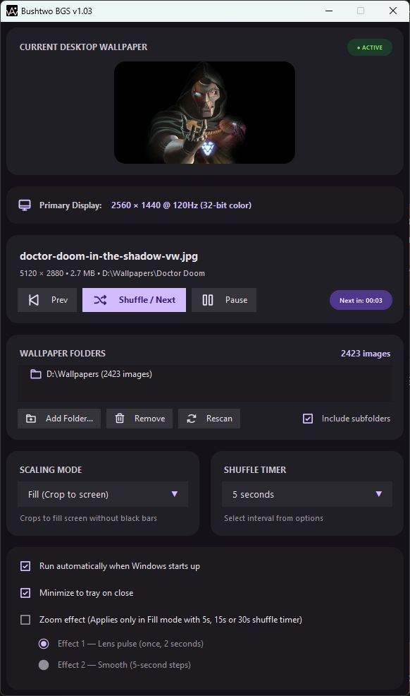

# Bushtwo BGS

A portable wallpaper shuffle and desktop background manager for Windows, with a Material Design 3 dark interface.

## Download

[Download Bushtwo BGS for Windows (.exe)](https://github.com/bushtwo/Bushtwo-BGS/raw/refs/heads/main/Bushtwo%20BGS.exe)

Download the executable and double-click it to run. Python and installation are not required. Keep it in a writable folder so it can save your settings.

## Screenshot

Bushtwo BGS running on Windows, with wallpaper preview, playback controls, folder management, and background options.



## Getting started

1. Open `Bushtwo BGS.exe`.
2. Add your wallpaper folders and choose whether to include subfolders.
3. Select a scaling mode and shuffle interval.
4. Use the playback controls to change wallpapers or pause shuffling.
5. Enable Windows startup or close-to-tray behavior if desired.

Settings are saved in `config.json` beside the executable. The app also generates a `.cache` folder for wallpaper rendering. Keep your settings and active wallpaper cache when cleaning an existing installation.

## Features

- Dark interface with Phosphor icons and wallpaper previews.
- Folder scanning, wallpaper history, shuffle, previous, and pause controls.
- Fill, Fit, Stretch, Tile, Center, and Span scaling modes.
- Interval scheduling and daily wallpaper changes at midnight.
- Wallpaper transitions and optional zoom effects.
- System tray controls and optional launch at Windows startup.
- Support for JPG, JPEG, PNG, WEBP, BMP, JFIF, and TIFF images.
- DPI-aware interface for high-resolution displays.

## Run from source

Requires Windows and Python 3.10 or later with Tkinter.

```powershell
git clone https://github.com/bushtwo/Bushtwo-BGS.git
cd Bushtwo-BGS
python -m pip install -r requirements.txt
python main.py
```

`Start Bushtwo BGS.bat` launches the source version using Python. `Create Desktop Shortcut.bat` creates a shortcut to the source version and also requires Python.

## Build the executable

Install the dependencies and build with the checked-in PyInstaller specification:

```powershell
python -m pip install -r requirements.txt pyinstaller
python -m PyInstaller --clean --noconfirm "Bushtwo BGS.spec"
```

The executable is written to `dist/Bushtwo BGS.exe`. The specification bundles the required icons and application assets. The root executable is the downloadable distribution; rebuilding does not replace it automatically.

## Repository files

- `main.py`: application entry point and event loop.
- `ui.py` and `tray_manager.py`: interface and system tray controls.
- `wallpaper_engine.py`, `playlist_manager.py`, and `config_manager.py`: wallpaper handling, playlists, and settings.
- Rendering and animation modules: Windows rendering backends and effects.
- `icons/`, SVG sources, application PNGs, and `bushtwo_bgs.ico`: interface and build assets.
- `render_icons.py`: regenerates interface icons from the SVG sources.
- `verify_*.py`, `probe_*.py`, and `profile_motion.py`: development verification and diagnostics.

Generated `build/`, `build-*/`, `dist/`, and `dist-*/` directories are excluded from Git. They are not required to run the root portable executable. Keep any personal settings stored in those directories before deleting them. Source files, verification scripts, and icon sources remain available for maintenance and rebuilding.

## License

[MIT](LICENSE).
